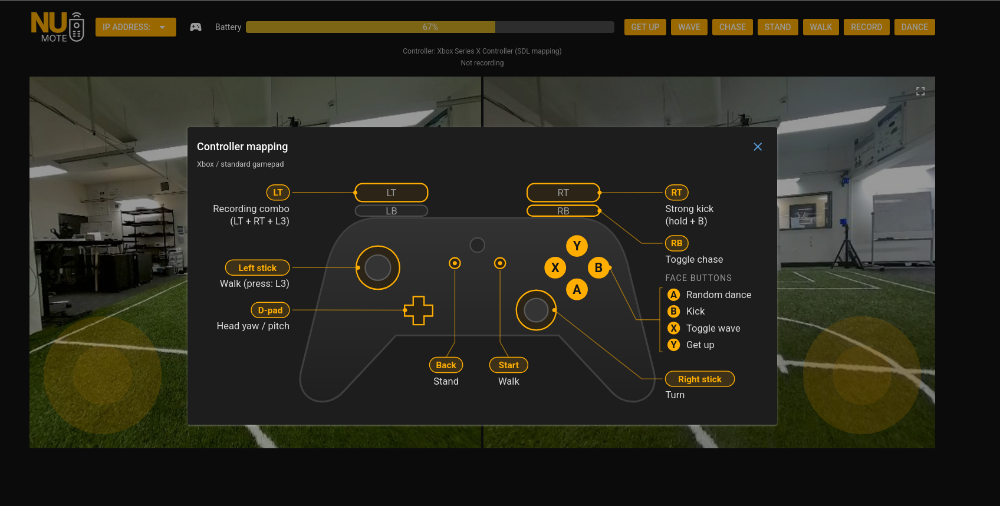
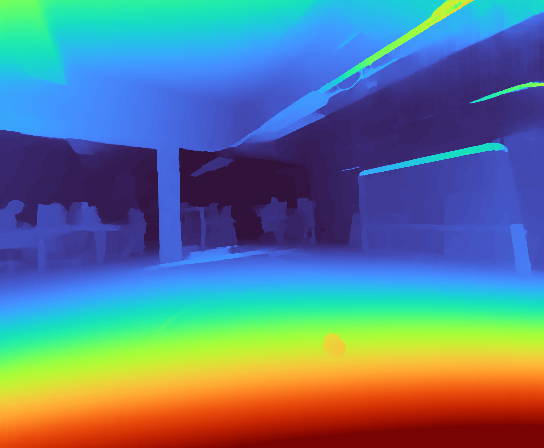

  

<h2 align="center">Hey, I'm Austin</h2>

  I enjoy building things, breaking things, and figuring out how to make them work.
  I'm studying Software Engineering at the University of Newcastle and working across
  industrial software, machine learning, and competitive robotics.

  <a href="https://a-bagnall.github.io/">Portfolio &#8599;</a>
  &nbsp;&middot;&nbsp;
  <a href="https://www.linkedin.com/in/austin-bagnall/">LinkedIn &#8599;</a>

  Orica Digital Solutions &middot; NUbots &middot; University of Newcastle

  Always happy to collaborate, work on interesting projects, or try something new feel free to reach out.

---

  
  
  
  
  
  
  
  
  
  
  
  
  
  
  
  
  
  
  
  

---

<h3 align="center">SuperMarioAgent &mdash; The Learning Levels</h3>

  

  An experiment in teaching an agent to play Super Mario Bros.

  Built a vectorised sprite-detection pipeline using OpenCV. 
  Trained an &epsilon;-greedy reinforcement-learning policy. 
  Achieved the first successful level completion after 17 epochs. 
  Built around <code>gym-super-mario-bros</code>.

  <a href="https://github.com/a-bagnall/mario-ml">View the project</a>

---

<h3 align="center">NUmote &mdash; Booster K1 Robot Remote</h3>

  

  A browser-based remote interface for NUbots' Booster K1 robots.

  Live camera feeds and video recording. 
  Gamepad and on-screen robot control. 
  Robot actions and network discovery.

  <a href="https://github.com/NUbots/NUmote">View the project</a>

---

<h3 align="center">NUbots &mdash; Stereo Depth and Perception</h3>

  
  &nbsp;
  

  Left camera image (left) and Fast Foundation Stereo depth map on the RDK X5 (right).

  Depth estimation and segmentation research for NUbots' Booster K1 robots.

  Depth map above generated from a stereo photo pair using Fast Foundation Stereo on the RDK X5. 
  Benchmarking stereo depth models against the X5's onboard depth output. 
  Benchmarking segmentation models for robot part detection. 
  Timing inference on the robot's own hardware (RDK X5 and Jetson Orin NX).

---

<h3 align="center">GPSTracker</h3>

  An Android geofencing app built for Orica Hackathon #4 (2025).

  Uses GPS enter/exit events to track geofenced areas. 
  Uses device tilt data to help identify and map potential danger zones. 
  Built from scratch in Kotlin during the hackathon.

  <a href="https://github.com/a-bagnall/GPSTracker">View the project</a>

---

  

  

  <picture>
    <source media="(prefers-color-scheme: dark)" srcset="https://raw.githubusercontent.com/a-bagnall/a-bagnall/output/github-contribution-grid-snake-dark.svg">
    <source media="(prefers-color-scheme: light)" srcset="https://raw.githubusercontent.com/a-bagnall/a-bagnall/output/github-contribution-grid-snake.svg">
    
  </picture>

