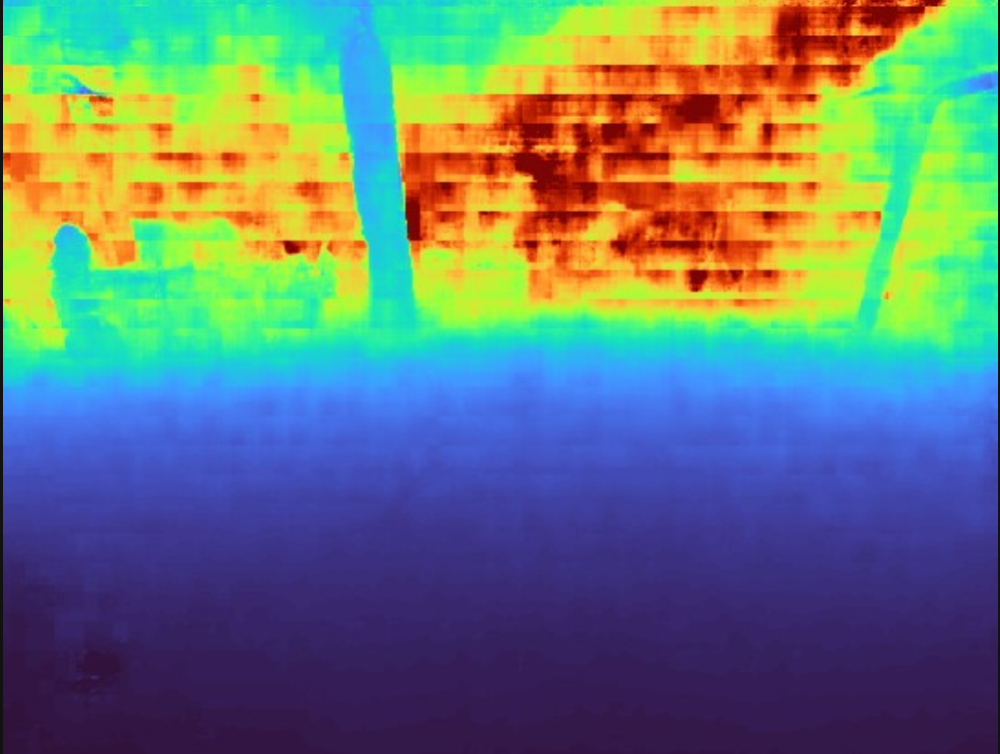
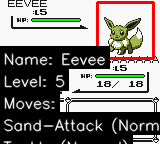

# Hey, I'm Austin

  

<h2 align="center">Hey, I'm Austin</h2>

  I enjoy building things, breaking things, and figuring out how to make them work again (hopefully). 
  I'm studying Software Engineering at the University of Newcastle and working as a Junior Machine Learning Engineer at Orica Digital Solutions. I'm also working on stereo depth and pose estimation for NUbots, an autonomous soccer robotics team.

  <a href="https://a-bagnall.github.io/">Portfolio &#8599;</a>
  &nbsp;&middot;&nbsp;
  <a href="https://www.linkedin.com/in/austin-bagnall/">LinkedIn &#8599;</a>

  Orica Digital Solutions &middot; NUbots &middot; University of Newcastle

---

<h3 align="center">Technologies &amp; Tools</h3>

  
  
  
  
  
  
  
  
  
  
  
  
  
  
  
  
  
  
  
  

---

<h3 align="center">SuperMarioAgent: The Learning Levels</h3>

  

<table align="center" width="100%">
  <tr>
    <td align="left">
      <ul>
        <li><strong>Personal Project</strong></li>
        <li>Built a vectorised sprite-detection pipeline using OpenCV.</li>
        <li>Trained an &epsilon;-greedy reinforcement-learning policy.</li>
        <li>Achieved the first successful level completion after 17 epochs.</li>
        <li>Built around <code>gym-super-mario-bros</code>.</li>
      </ul>
    </td>
  </tr>
</table>

<table align="center" width="100%">
  <tr>
    <td align="left">
      <ul>
        <li>Started by training an agent to complete World 1-1, succeeding in under 20 epochs.</li>
        <li>Extended training to World 1-2, using only sprite information and experience from the first level.</li>
        <li>Explored how much training data was needed to generalise to the remaining levels.</li>
        <li>Developed as a proving ground for a larger reinforcement-learning project.</li>
      </ul>
    </td>
  </tr>
</table>

  <a href="https://github.com/a-bagnall/mario-ml">View the project &#8599;</a>

---

<h3 align="center">NUbots: Stereo Depth &amp; Pose Estimation</h3>

<table align="center" width="100%">
  <tr>
    <td align="center" width="50%">
      
       
      Booster default depth output
    </td>
    <td align="center" width="50%">
      
       
      Fast Foundation Stereo on the RDK X5
    </td>
  </tr>
</table>

<table align="center" width="100%">
  <tr>
    <td align="left">
      <ul>
        <li>Evaluating stereo depth models against the depth data already provided by the robot, including Fast Foundation Stereo, Lite Any Stereo V2 and RAFT-Stereo.</li>
        <li>Comparing segmentation models to find a balance between inference speed and accuracy.</li>
        <li>Testing models directly on the robot's hardware (RDK X5 and Jetson Orin NX) to evaluate real-time performance.</li>
        <li>Developing a pipeline that detects a robot in one camera view, then uses stereo depth and part segmentation to estimate its 3D pose.</li>
        <li>Building a labelled dataset of robot body parts (head, shoulders, torso and feet) for per-part segmentation and pose estimation.</li>
      </ul>
    </td>
  </tr>
</table>

---

<h3 align="center">NUmote &mdash; Booster K1 Robot Remote</h3>

  

<table align="center" width="100%">
  <tr>
    <td align="left">
      <ul>
        <li>Browser-based remote control interface for Booster K1 robots, built with Python and NiceGUI.</li>
        <li>Real-time robot control using on-screen joysticks or Xbox and Nintendo Switch controllers, with adjustable movement speed and head positioning.</li>
        <li>Live camera streaming with support for RGB, depth and object detection feeds through a custom ROS 2 bridge.</li>
        <li>Robot communication and control through gRPC, Protocol Buffers, WebSockets and TCP.</li>
        <li>Trigger built-in robot behaviours, including dancing, kicking, waving, getting up and ball chasing.</li>
        <li>Video recording, automatic robot discovery and SSH-based deployment and management of the custom camera bridge.</li>
      </ul>
    </td>
  </tr>
</table>

  <a href="https://github.com/NUbots/NUmote">View the project &#8599;</a>

---

<h3 align="center">PokeAI</h3>

  

<table align="center" width="100%">
  <tr>
    <td align="left">
      <ul>
        <li>Uses Open-CV to detect Pokemon and then web scrapes Bulbapedia for moveset.</li>
        <li>Example detection output shown above, featuring Eevee.</li>
      </ul>
    </td>
  </tr>
</table>

<table align="center" width="100%">
  <tr>
    <td align="left">
      <ul>
        <li>The goal is to eventually teach an Agent to play through the first generation of Pokemon</li>
        <li>The first goal is to first leave Pallet Town, but really it's beating Brock.</li>
        <li>The second goal would be to beat Misty + Lt. Surge</li>
        <li>But the overarching goal with this project is to dream to beat the Elite Four, but then zero-shot Generation II based on nothing but Open-CV teaching an RL policy to detect Pokemon Sprites + knowing type weaknesses/strengths.</li>
      </ul>
    </td>
  </tr>
</table>

---

<h3 align="center">GPSTracker</h3>

  An Android geofencing app built for Orica Hackathon #4 (2025).

<table align="center" width="100%">
  <tr>
    <td align="left">
      <ul>
        <li>Uses GPS enter and exit events to track geofenced areas.</li>
        <li>Uses device tilt data to help identify and map potential danger zones.</li>
        <li>Built from scratch in Kotlin during the hackathon.</li>
      </ul>
    </td>
  </tr>
</table>

  <a href="https://github.com/a-bagnall/GPSTracker">View the project &#8599;</a>

---

<h3 align="center">GitHub Activity</h3>

  

  

  <picture>
    <source media="(prefers-color-scheme: dark)" srcset="https://raw.githubusercontent.com/a-bagnall/a-bagnall/output/github-contribution-grid-snake-dark.svg">
    <source media="(prefers-color-scheme: light)" srcset="https://raw.githubusercontent.com/a-bagnall/a-bagnall/output/github-contribution-grid-snake.svg">
    
  </picture>

